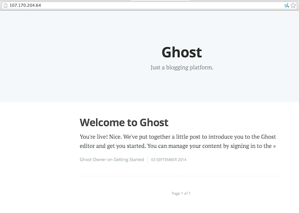

# Getting Started with Your Nitrous.IO Environment by Setting Up a Ghost Blog.

## Overview

*This tutorial will quickly walk you through setting up a Ghost Blog on the new Nitrous.IO. If you need further details on any CLI command, enter a command in your terminal without parameters to get detailed information about the various options.*

## Step 1: Install the Nitrous.IO Command Line Interface (CLI) for your operating system.

* [Download Nitrous for Mac](https://osx.nitrous.io/nitro-latest-darwin_amd64.pkg)

## Step 2: Authenticate with your Nitrous.IO credentials.


$ nitro login


## Step 2b: Optional - for Staging Only.

Set the `NITRO_API_URL` environment variable.


$ export NITRO_API_URL=https://pro.nitrous.io


## Step 3: Create a new Host. Specify size, region and a unique host name.


$ nitro hosts:create 512mb -r sfo -s HOST_NAME


Or issue the command without parameters to see all the options.


$ nitro hosts:create
    Usage: nitro hosts:create <size>

  create a new host

  Options:

  size
  -r, --region=""       Region in which you want to create the host
  -s, --slug=""         A unique slug for the host


## Step 4: Pull an Existing Image onto the Host.


$ nitro images:pull HOST_NAME dockerfile/ghost
  Pulling image 'dockerfile/ghost' to 'HOST_NAME'...
  ID                   Slug                Tag       Name   Created                                 Size   Virtual Size
  aad91b0a4e8311738f   dockerfile/ghost    latest           2014-09-03 00:08:20.995835 +0000 UTC    0      602771479


Step 4b: Alternately, you can also build your own DockerFile if you have an existing copy.


$ nitro images:build HOST_NAME ./Dockerfile


## Step 5: Setup a Data Volume.

This is where your data will be stored - isolating your data from your computer. You can then make changes to your application without affecting your data.


$ nitro volumes:create HOST_NAME data


## Step 6: Create a Container using the Data Volume and with Port Forwarding.

Now we can create a new Container, connect the Data Volume we created to the Container and link the appropriate port from the Container out to the host. Container linking also allows you to connect various microservices in your application stack to one another.


$ nitro create HOST_NAME -s CONTAINER_NAME -i dockerfile/ghost -p 0.0.0.0:80:2368 -v data:/ghost-overide


Using the command above, a Container will be created using the Image dockerfile/ghost with Ports forwarded 80:2368 and Data Volume mounted.

## Step 7: Connect to the Container via shell.

We can ensure that the Container came up properly by accessing it.


$ nitro shell CONTAINER_NAME


Now we can access the Ghost Blog locally within the Container:


$ curl localhost:2368


## Step 8: Access the Service on Web.

Find the URL to your host and point your browser to your new Ghost Blog.


$ nitro hosts:inspect HOST_NAME
Slug    State    Size   IP              Hostname
devbox  running  512mb  107.170.204.64  HOST_NAME.nitrouspro.com

Uptime  Memory Used (bytes)  Memory Total (bytes)  Storage Used (bytes)
Storage Total (bytes)  Number of CPUs  CPU 0 Usage
2315    502894592            513875968             4471504896
21003628544            1               0.00 %


You have now successfully set up a Ghost Blog.

## Recommended Articles

Check out the [Private Repository Tutorial](/docs/private-registry/) to pull an existing Docker Image from your Private Repository.
