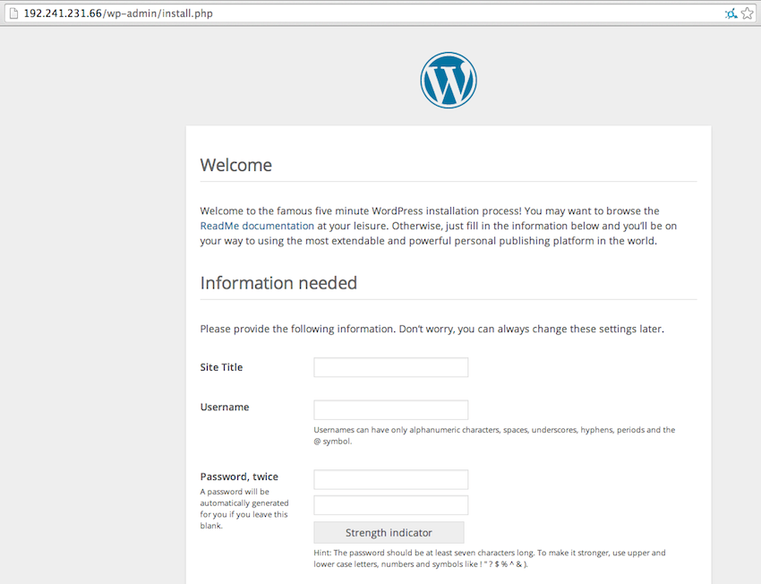

# Setting Up a WordPress Site

## Overview

This will quickly walk you through setting up a new WordPress site, which will run on Apache and will connect to a MySQL database.

This guide assumes that you have the [Nitro CLI installed]({{site.baseurl}}/download/) and a [Host created on Nitrous.IO]({{site.baseurl}}/getting-started/).

## Step 1: Create a Container and Install the Latest Version of WordPress

Let's start with creating a volume for our WordPress data:


$ nitro volumes:create wordpress


Now you can build your container on an existing host, utilizing the nitrous/wordpress image on Docker Hub:


$ nitro create HOST_NAME -i nitrousio/php -s wordpress -p public:80:80 -v wordpress:/var/www/html
Creating container on 'HOST_NAME'. Please wait...
Created new container: 'wordpress'
Slug         Image            State
wordpress    nitrousio/php    running


You have now created a new container named 'wordpress' with port 80 being forwarded. The container starts with PHP/Apache2, but you will still need to install WordPress. Shell into the container and create the WordPress installation with the following commands:


$ nitro shell wordpress
# cd /var/www/html && wget https://wordpress.org/latest.tar.gz && tar -xvzf latest.tar.gz && rm latest.tar.gz && mv wordpress/* ./ && rm -rf wordpress/


## Step 2: Prepare a MySQL Database

To connect WordPress to a MySQL database you will need to make a separate container for it. Start by creating a volume. This is where the actual data will be stored.


$ nitro volumes:create HOST_NAME mysql
Creating volume on 'HOST_NAME'. Please wait...
Created new volume: 'mysql'


Next, create the MySQL container which will run the database service. Create a private container, and forward port 3306 so the database can be accessed.


$ nitro create HOST_NAME -i tutum/mysql -s mysql -p private:3306:3306 -v mysql:/var/lib/mysql
Creating container on 'HOST_NAME'. Please wait...
  Created new container: 'mysql'
  Slug        Image       State
  mysql       mysql       running


>Notice that when specifying the port we appended `private:` before it. You can specify if you want the container to be `private` or `public` to outside connections by specifying this option.

Shell into the mysql container we just created and create a database called 'wordpress':


$ nitro shell mysql



$ mysql
mysql> create database wordpress;
Query OK, 1 row affected (0.00 sec)

mysql> show databases;
+--------------------+
| Database           |
+--------------------+
| information_schema |
| mysql              |
| performance_schema |
| wordpress          |
+--------------------+
4 rows in set (0.00 sec)


## Step 3: Connect the WordPress Container to MySQL

In this step we will identify the admin password for your MySQL database, and configure your wp-config file within the wordpress container.

### Indentify the MySQL Password

Before configuring the database, take note of your admin password on the MySQL container. To acquire the database password, run the logs command:


$ nitro logs mysql
=> An empty or uninitialized MySQL volume is detected in /var/lib/mysql
=> Installing MySQL ...
=> Done!
=> Creating admin user ...
=> Waiting for confirmation of MySQL service startup
=> Creating MySQL user admin with random password
=> Done!
========================================================================
You can now connect to this MySQL Server using:

    mysql -uadmin -pTSXD1RRYVsWP -h<host> -P<port>

    Please remember to change the above password as soon as possible!
    MySQL user 'root' has no password but only allows local connections
========================================================================


Your password will be found just after **-p**.

### Configure wp-config.php

Next, shell into your wordpress container and create `wp-config.php`:


$ nitro shell wordpress
root@wordpress:~# cd /var/www/html
root@wordpress:~# vim wp-config.php


Within `wp-config.php`, include the following settings:


<?php
/**
 * The base configurations of the WordPress.
 *
 * This file has the following configurations: MySQL settings, Table Prefix,
 * Secret Keys, WordPress Language, and ABSPATH. You can find more information
 * by visiting {@link http://codex.wordpress.org/Editing_wp-config.php Editing
 * wp-config.php} Codex page. You can get the MySQL settings from your web host.
 *
 * This file is used by the wp-config.php creation script during the
 * installation. You don't have to use the web site, you can just copy this file
 * to "wp-config.php" and fill in the values.
 *
 * @package WordPress
 */

// ** MySQL settings - You can get this info from your web host ** //
/** The name of the database for WordPress */
define('DB_NAME', 'wordpress');

/** MySQL database username */
define('DB_USER', 'admin');

/** MySQL database password */
define('DB_PASSWORD', '<locate password by running 'nitro logs DATABASE_CONTAINER>');

/** MySQL hostname */
define('DB_HOST', '172.17.42.1');

/** Database Charset to use in creating database tables. */
define('DB_CHAutf8');

/** The Database Collate type. Don't change this if in doubt. */
define('DB_COLLATE', '');

/**#@+
 * Authentication Unique Keys and Salts.
 *
 * Change these to different unique phrases!
 * You can generate these using the {@link https://api.wordpress.org/secret-key/1.1/salt/ WordPress.org secret-key service}
 * You can change these at any point in time to invalidate all existing cookies. This will force all users to have to log in again.
 *
 * @since 2.6.0
 */
define('AUTH_KEY',         'put your unique phrase here');
define('SECURE_AUTH_KEY',  'put your unique phrase here');
define('LOGGED_IN_KEY',    'put your unique phrase here');
define('NONCE_KEY',        'put your unique phrase here');
define('AUTH_SALT',        'put your unique phrase here');
define('SECURE_AUTH_SALT', 'put your unique phrase here');
define('LOGGED_IN_SALT',   'put your unique phrase here');
define('NONCE_SALT',       'put your unique phrase here');

$table_prefix  = 'wp_';
define('WPLANG', '');
define('WP_DEBUG', false);

if ( !defined('ABSPATH') )
    define('ABSPATH', dirname(__FILE__) . '/');

require_once(ABSPATH . 'wp-settings.php');


## Step 4: Access and Configure Your WordPress Site

Find the URL (or IP) to your host and point your browser to your WordPress site.


$ nitro hosts:inspect HOST_NAME
Slug       State    Size   IP              Hostname
HOST_NAME  running  512mb  192.231.241.46  HOST_NAME.nitrouspro.com

Uptime  Memory Used (bytes)  Memory Total (bytes)  Storage Used (bytes)  Storage Total (bytes)  Number of CPUs  CPU 0 Usage
163971  473505792            513921024             4559187968            21003628544            1               0.00 %


If everything is configured correctly then you will be prompted to setup your WordPress username and password.

Your WordPress site is ready to go.

