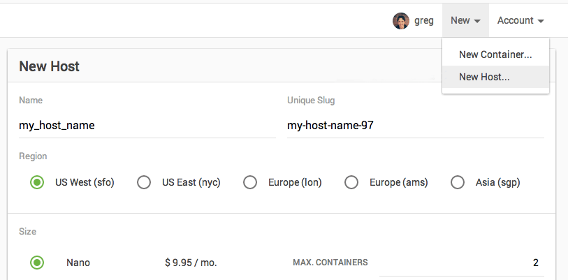
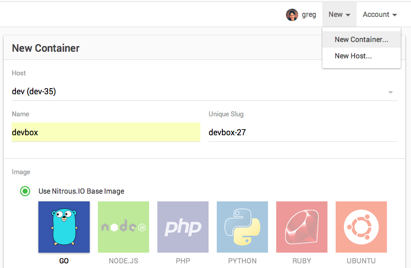

# Hosts and Containers

## Create a Host

The first steps to getting started is to create a host. This can be done by navigating to **New > Host** within your
Dashboard and specifying the size and region you want to use.

Alternatively you can use the `nitro hosts:create` command using the Nitrous CLI.

e.g.

$ nitro hosts:create 512mb sfo -s my_host_name


## Create a Container

Once you have a host running you can start creating containers. Remember that your host has a set amount of
resources, so you may want to utilize multiple hosts if you are wanting to designate a certain amount of resources to specific containers.

You can quickly create a new container within the Dashboard by navigating to **New > Container**, and configuring the name, image, volumes (optional), and ports (optional).

If you are using the Nitro CLI then you will want to run the following command to create a new container:


$ nitro create <host_name> -s <container_name> -i username/repo


When creating a new container you have a few optional commands:

* Specify a unique slug if you do not wish to have one automatically generated.
* Expose ports with the `-p` tag. Prepend `private:` or `public:` before the ports to specify whether they should be exposed to only other containers or to the public.
* Specify an existing volume and mount it to a specific directory with the `-v` tag.

e.g:

$ nitro create <host_name> -s <container_name> -i username/repo -s <your_unique_slug> -p private:80:80 -v <volume_name>:/<mount_directory>


