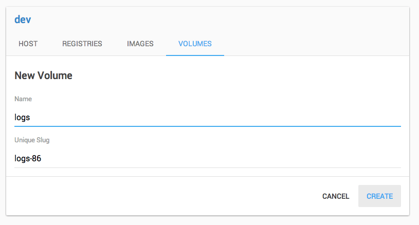
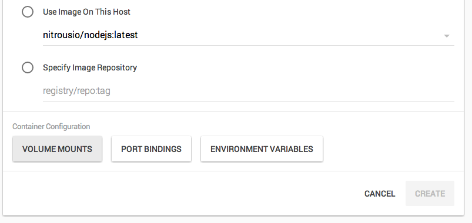
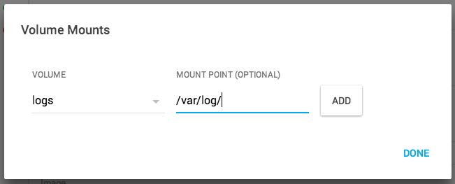
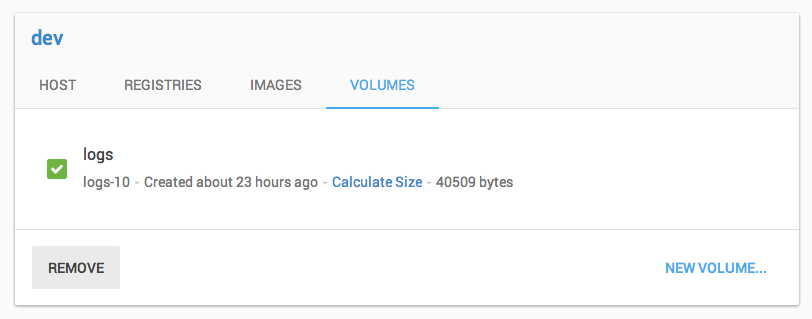

# Managing Volumes

## Overview

A volume is a specially-designated directory which you can access through one or more containers. Once a volume is
created within your Nitrous host it can be accessed by any other container within that host.

## Create a Host

In order to create a volume you will first need a running host. See the [Hosts and
Containers](/hosts-and-containers) guide for steps on setting this up.

## Create an Empty Volume

Within your Dashboard, click on your host name followed by clicking the **Volumes** tab.

In the next screen click **New Volume** and give your volume a title.

## Attach a Volume with a Container

When creating a new container you can select a volume to mount to it. Every volume created within that host can be accessed by any container within the same host.

Navigate in your Dashboard to **New Container** and select **Volume Mounts**.

Select the volume you just created and enter in a mount point. For this example we are attaching the logs volume, and mounting it to `/var/logs/`.

Click on your newly created container and navigate to the terminal. Once logged in the box should have already
created log files within `/var/log/`, and they have been saved to your volume permanently. These logs can now be
accessed by any other container within your host. If you want to access the log files in another location other than
`/var/logs` then you will want to specify the mount point when creating a new container.

## Delete a Volume

Within your Dashboard, click on the hostname which contains your volume. Next, click the **Volumes** tab and check
the volume(s) you wish to delete. Click **REMOVE** and the volume will be deleted.

If using the CLI, run the following command to delete a volume:


$ nitro volumes:remove <host_name> <volume_name>


