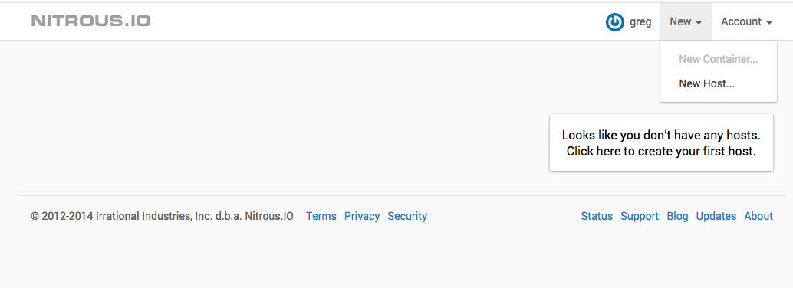

## Overview

*This tutorial introduces you to key Nitrous.IO concepts by walking you through the process of setting up the blogging platform, Ghost, on Nitrous.IO.*

## Prerequisites

* A Nitrous Pro account
* Nitrous Pro Sync

## Create a Host

[Login](https://pro.nitrous.io/#/login) to your Nitrous account and select **New > Host** from the menu.

Give your host a name, and select a size (for this example you can select Nano). From there, select **Create** and your new host will be created in a moment.

## Create a Container

* Within a Host you can create multiple containers. A container could be your development environment, a database service, or any repository found within the [Docker Hub Registry](https://registry.hub.docker.com/).*

Navigate to **New > Container** within the menubar. From there title your container  with a name of your choice.  Under the **Image** field, type `dockerfile/ghost` within the "Specify Image Repository" field.

## 

