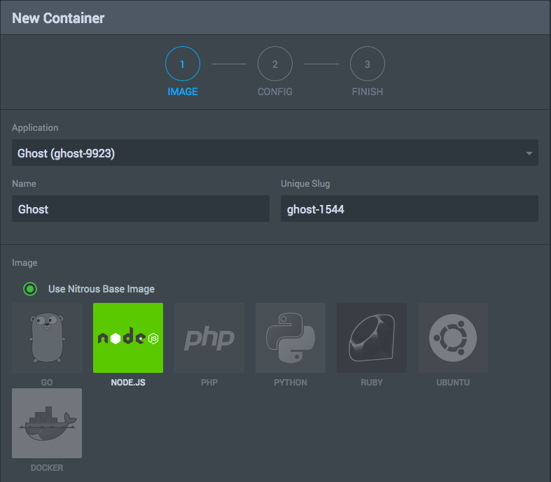
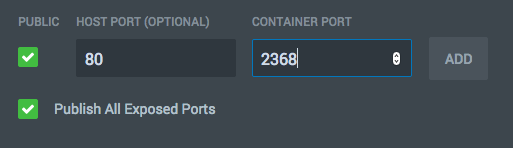
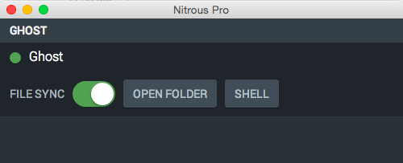
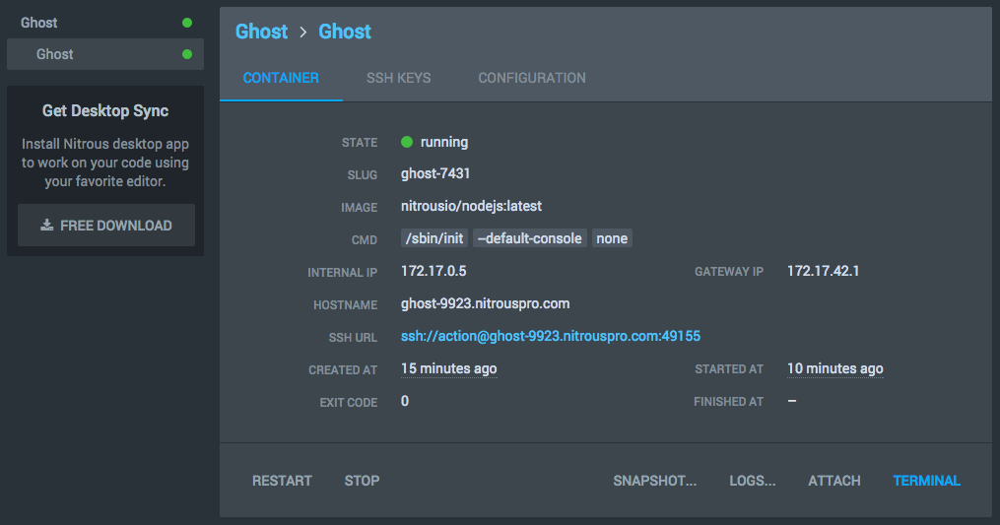
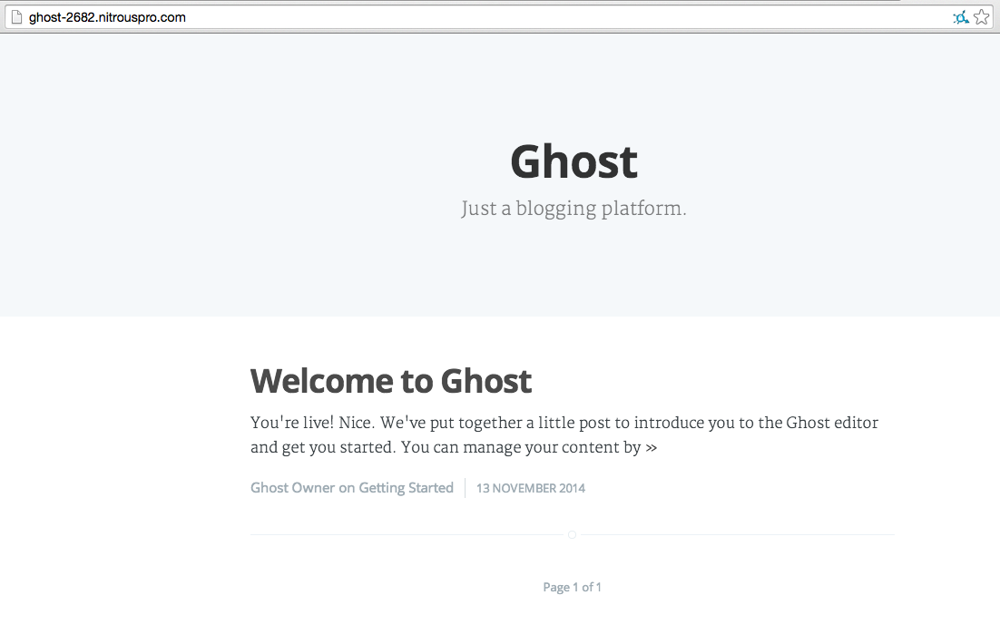

## Overview

*This tutorial introduces you to key Nitrous.IO concepts by walking you through the process of setting up the blogging platform, Ghost, on Nitrous.IO.*

## Prerequisites

* A Nitrous Pro account
* [Nitrous Desktop](/nitrous-desktop)

## Create the Ghost Application

[Login](https://pro.nitrous.io/#/login) to your Nitrous account and select **New > Application** from the menu. For this example a nano sized host will work.

After configuring your host, select **Create** and your new host will be available in a moment.

## Create a Container

*Within a Host you can create multiple containers. A container could be your development environment, a database service, or any repository found within the [Docker Hub Registry](https://registry.hub.docker.com/). By using a Nitrous Base image you will have instant access to sync projects locally.*

Navigate to **New > Container** within the menu. Give your container a name such as "Ghost", and under the **Image** field select **Node.JS** under **Nitrous Base Image**.

Click next to go to step 2. Within this step we will need to add port bindings. Within the Port Bindings section, add the following public port:

* Host Port: 80
* Container Port: 2368

Click **Create** and Nitrous will pull the latest Ghost image with your configurations.

## Sync with Nitrous Desktop

Open up [Nitrous Desktop](/nitrous-desktop) and you will see your Node.JS container. In order to install Ghost on your Node.JS container, click on **Shell** to open up a shell session.

When the terminal opens your shell connection, run the following commands to download and extract Ghost:

    $ cd workspace/
    $ wget https://ghost.org/zip/ghost-latest.zip && unzip ghost-latest.zip -d ~/workspace/app && rm -f ghost-latest.zip

Next, cd into the app folder which the project files were extracted to and run npm install.

    $ cd app/
    $ npm install

Next, modify the host in the configuration to `0.0.0.0` and add the user `ghost`.

    $ sudo sed 's/127.0.0.1/0.0.0.0/' ~/workspace/app/config.example.js > ~/workspace/app/config.js
    $ sudo useradd ghost --home ~/workspace/app

Your Ghost blog should be ready to go at this point. Run your app with npm start.

    $ npm start

## Previewing

Navigate to your Ghost application within the Dashboard to see the configurations. You will find the publicly available URL of your app under **Hostname**.

In this example the **Hostname** is `ghost-2682.nitrouspro.com`. Paste this URL into the browser to view your new Ghost blog.

